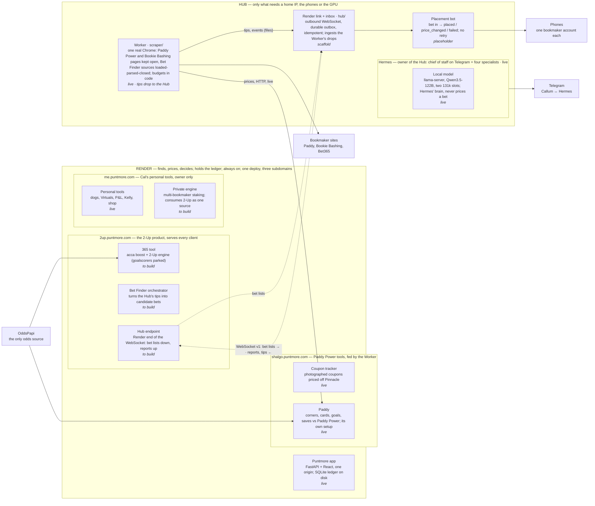

# Puntmore architecture

Two physical boxes. **Render** finds, prices and decides bets, holds the ledger and serves the app. The **Hub**, on a home connection and owned by Hermes, does only what needs a home IP, the phones or the GPU: bookmaker pages, placement, and the judgement calls when something goes wrong.

This is the one source for the architecture. The spec it implements is `docs/2up-engine-spec.md`; decisions are settled in `PLAN.md` → Decisions; rules are in `CLAUDE.md` and each directory's `AGENTS.md`. Update this file in the same pull request as the change it describes.

*As of 5 Nov 2026. State legend: **live** built and running · **scaffold** built, tested with fakes · **placeholder** a contract and a stub · **to build** specified, not started · **parked** code kept, switched off.*

## What runs where

## Components

| Component | What it is | Where | State |
|---|---|---|---|
| Puntmore app | One FastAPI + React deploy serving the three hostnames; SQLite ledger on disk | Render | live |
| 365 tool | Bet365 offers as one tool: acca boost, 2-Up engine; goalscorers parked | Render · 2up | to build (acca returns on OddsPapi; 2-Up spec only) |
| Bet Finder orchestrator | Turns the Hub's tips into candidate bets | Render · 2up | to build |
| Hub endpoint | The Render end of the WebSocket | Render · 2up | to build (contract in `hub/PROTOCOL.md`) |
| Coupon tracker | Photographed coupons priced off Pinnacle via the score grid | Render · shalgo | live |
| Paddy | Corners, cards, goals and saves against Paddy Power; its own setup, fed by the Worker | Render · shalgo | live |
| Personal tools | Dogs, Virtuals, P&L, Kelly, shop | Render · me | live, owner only |
| Private engine | Multi-bookmaker staking that consumes 2-Up as one source | Render · me | to build, to spec separately |
| Hermes | Owner of the Hub: chief of staff and four specialists | Hub | live (delegation plugin pending) |
| Local model | llama-server, Qwen3.5-122B, two slots; Hermes' brain, never in the pricing path | Hub, inside Hermes | live |
| Worker | `scraper/`: one real Chrome; Paddy Power and Bookie Bashing pages kept open, Bet Finder sources as `generic` targets | Hub | live (parsers partly written; sources drop tips to the Hub) |
| Placement bot | Bet in, placed / price_changed / failed out, on the phones | Hub | placeholder (dry-run adapter only; contract in `hub/puntmore_hub/placement/README.md`) |
| Render link + inbox | `hub/`: outbound WebSocket, durable outbox, client engine, the Worker's drops ingested; updates itself from `origin/main` every 10 min (`puntmore-update.timer`) | Hub | scaffold, 65 tests; waits on the Hub endpoint |
| Wire contract | `hub/PROTOCOL.md`, JSON Schema, examples, mock Render | both | v1, contract tests |

## The Render ↔ Hub contract

| Direction | Messages |
|---|---|
| Render → Hub | `bet_list`, `scrape_job`, `kill_switch`, `ping`, `ack` |
| Hub → Render | `hello`, `report` (placed, price_changed, failed, settled, balance), `tip`, `scrape_result`, `escalation`, `escalation_outcome`, `pong`, `ack` |
| Rules | outbound from the Hub only · bearer key · every message idempotent on `msg_id`, every bet on `bet_id` · a failed bet is never resent |

## Fixed by the spec

1. **Dry-run by default.** Two weeks of clean reports before real money.
2. **Kill switch is a file**, `hub/data/KILL`; no code change to flip.
3. **No retry, no re-route.** Failures go to the local AI.
4. **Real Chrome, no stealth.** Budgets in code, 24 h cool-off on a challenge.
5. **Bet Finder tips are owner-only.** Never offered to other clients.
6. **OddsPapi is the only odds source.** Render never loads a bookmaker page and never places a bet.
7. **Three subdomains, one deploy**, by design; not expected to scale beyond this.

## Open decisions and known weaknesses

1. **Placement is a stub.** One phone in dry-run is the next real milestone; everything else on the Hub is scaffolding around it. The local model is building the adapter.
2. **Folded (5 Nov):** the Bet Finder's sources are Worker targets; `hub/` no longer scrapes.
3. **Fixed (5 Nov):** `hub/` updates itself. `puntmore-update.timer` fast-forwards the box's checkout to `origin/main` every 10 minutes, reinstalls and restarts, never while a bet is in flight (`hub/README.md`, "Updating the Hub"). `scraper/` updates itself from an image.
4. **The placement service should run as its own Linux user** so no agent can read account credentials, whatever a scraped page says.
5. **Goalscorers** returns only via OddsPapi, after the open work (PLAN.md, Parked).
