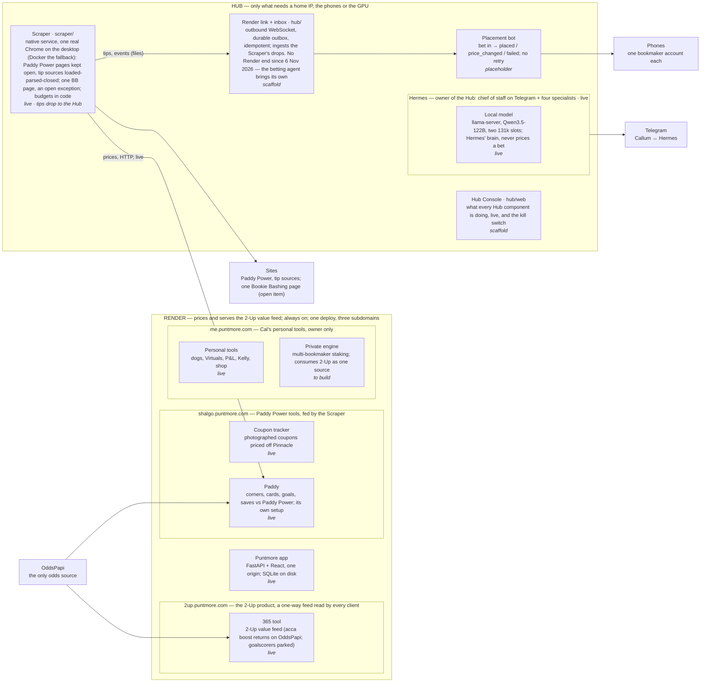

# Puntmore architecture

Two physical boxes. **Render** prices and serves the 2-Up value feed (a one-way HTTP feed; it keeps no ledger and places nothing) and serves the app. The **Hub**, on a home connection and owned by Hermes, does only what needs a home IP, the phones or the GPU: bookmaker pages, placement, and the judgement calls when something goes wrong.

This is the one source for the architecture. The spec it implements is `docs/2up-engine-spec.md`; decisions are settled in `docs/decisions.md` (read first; it wins), then `PLAN.md` → Decisions; rules are in `CLAUDE.md` and each directory's `AGENTS.md`. Update this file in the same pull request as the change it describes.

*As of 6 Nov 2026. State legend: **live** built and running · **scaffold** built, tested with fakes · **placeholder** a contract and a stub · **to build** specified, not started · **parked** code kept, switched off.*

## What runs where

## Components

| Component | What it is | Where | State |
|---|---|---|---|
| Puntmore app | One FastAPI + React deploy serving the three hostnames; SQLite on disk | Render | live |
| 365 tool | Bet365 offers as one tool: the 2-Up value feed (`render/api/app/twoup/`): a served board refreshed by the `twoup_refresh` job, read at `GET /api/2up/feed` and on the 2-Up tab (Feed alone, with "updated" and "priced" times); acca boost returns on OddsPapi; goalscorers parked | Render · 2up | live |
| Coupon tracker | Photographed coupons priced off Pinnacle via the score grid | Render · shalgo | live |
| Paddy | Corners, cards, goals and saves against Paddy Power; its own setup, fed by the Scraper | Render · shalgo | live |
| Personal tools | Dogs, Virtuals, P&L, Kelly, shop | Render · me | live, owner only |
| Private engine | Multi-bookmaker staking that consumes 2-Up as one source | Render · me | to build, to spec separately |
| Hermes | Owner of the Hub: chief of staff and four specialists | Hub | live (delegation plugin pending) |
| Local model | llama-server, Qwen3.5-122B, two slots; Hermes' brain, never in the pricing path | Hub, inside Hermes | live |
| Scraper | `scraper/`: user service `puntmore-scraper`, one real Chrome on the desktop session (Docker the fallback for a box with no screen); Paddy Power pages kept open, the one Bookie Bashing page (`bb-saves`) an open exception (`docs/decisions.md`), tip sources as `generic` targets; what it reads is `targets.toml` on the Hub, nothing on Render | Hub | live (sources drop tips to the Hub) |
| Placement bot | Bet in, placed / price_changed / failed out, on the phones | Hub | placeholder (dry-run adapter only; contract in `hub/puntmore_hub/placement/README.md`) |
| Render link + inbox | `hub/`: outbound WebSocket, durable outbox, client engine, the Scraper's drops ingested (no Render end since 6 Nov 2026); updates itself from `origin/main` every 10 min (`puntmore-update.timer`) | Hub | scaffold |
| Hub Console | `hub/puntmore_hub/web/`, `puntmore web`: what every Hub component is doing, live, and the kill switch; the CLI's actions behind a token | Hub | scaffold (localhost by default; reads what the CLI reads) |
| Wire contract | `hub/PROTOCOL.md`, JSON Schema, examples, mock Render | the Hub only | v1, contract tests; no Render end until the betting agent defines its own |

## The Render ↔ Hub contract

There is none since 6 Nov 2026. Render's end of the WebSocket (`/api/2up/ws`, `app/hub/`, the `hub` grant) is removed; the 2-Up module is a one-way feed that the betting agent reads over HTTP, and the betting agent defines its own Hub endpoint in its own spec. `hub/PROTOCOL.md` describes the Hub's side as it was built and has no Render end until then.

## Fixed by the spec

1. **Dry-run by default** (the betting agent's and the Hub's placement). Two weeks of clean reports before real money.
2. **Kill switch is a file**, `hub/data/KILL`; no code change to flip.
3. **No retry, no re-route** on the Hub's placement. Failures go to the local AI.
4. **Real Chrome, no stealth.** Budgets in code, 24 h cool-off on a challenge.
5. ~~Bet Finder tips are owner-only on Render~~ (removed 6 Nov 2026): Bet Finder is not a Render instance; tip finding is the client's.
6. **OddsPapi is the only odds source.** Render never loads a bookmaker page, never places a bet and keeps no record of any client's bets.
7. **Three subdomains, one deploy**, by design; not expected to scale beyond this.

## Open decisions and known weaknesses

1. **Placement is a stub.** One phone in dry-run is the next real milestone; everything else on the Hub is scaffolding around it. The local model is building the adapter.
2. **Folded (5 Nov):** the Bet Finder's sources are Scraper targets; `hub/` no longer scrapes.
3. **Fixed (5 Nov):** `hub/` updates itself. `puntmore-update.timer` fast-forwards the box's checkout to `origin/main` every 10 minutes, reinstalls and restarts, never while a bet is in flight (`hub/README.md`, "Updating the Hub"). `scraper/` (the Scraper's user service) is restarted by the same timer; the Docker image is the fallback.
4. **The placement service should run as its own Linux user** so no agent can read account credentials, whatever a scraped page says.
5. **Goalscorers** returns only via OddsPapi, after the open work (PLAN.md, Parked).
