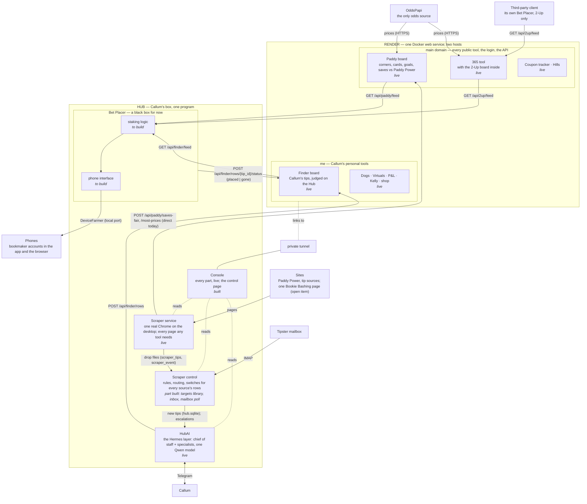

# Puntmore architecture

Two boxes. **Render** prices markets and serves the boards; it never loads a bookmaker page and
never places a bet. The **Hub**, Callum's box on a residential connection, runs one program in
five parts: it reads every page, judges tips, and is where bets are placed from. The names are
the register's (`docs/decisions.md`, "Names and structure"); the register wins over this file.
Update this file in the same pull request as the change it describes.

*As of 6 Nov 2026. State: **live** built and running · **built** built and tested, not yet in
daily use · **to build** specified, not started · **parked** code kept, switched off.*

## The picture

## Components

| Component | What it is | Where | State |
|---|---|---|---|
| Render service | FastAPI + React, one origin, SQLite on the disk; the main domain and `me` (`app/site.py`) | Render | live |
| Paddy | Corners, cards, goals and saves against Paddy Power (`app/cards/`); OddsPapi plus the Scraper's posts | Render · main | live |
| 365 tool, 2-Up | bet365's offers; 2-Up (`app/twoup/`) is a served board refreshed by `twoup_refresh`, read at `GET /api/2up/feed` and on the 2-Up tab; acca boost returns on OddsPapi; goalscorers parked | Render · main | live |
| Coupon tracker, Hills | photographed coupons priced off the score grid; William Hill boosts | Render · main | live |
| Finder | `finder_rows`, its status machine, `/api/finder/*` (`app/finder/`, `docs/finder-spec.md`) | Render · me | live, Callum only |
| Personal tools | dogs, Virtuals, P&L, Kelly, shop | Render · me | live |
| Scraper service | `scraper/`, user service `puntmore-scraper`: one real Chrome on the desktop session, budgets in code (Docker is the fallback for a box with no screen) | Hub | live |
| Scraper control | `targets.toml` changed only through `scraper/targets.py` (Console, CLI, HubAI); the Hub daemon's inbox of the drop files and its tipster-mailbox poll (`hub/`) | Hub | part built |
| HubAI | the Hermes layer: chief of staff on Telegram, specialist profiles, Qwen3.5-122B under llama-server; judges tips for Finder (`puntmore finder`), takes every escalation | Hub | live |
| Bet Placer | reads the three feeds, sizes, places through DeviceFarmer, keeps the only book, posts `placed` / `gone` to Finder (`docs/placer-spec.md`); starts from the placement engine in `hub/puntmore_hub/placement/` (dry-run adapter only) | Hub; third parties, 2-Up only | to build |
| Console | `puntmore web`: a card per part, the kill switch, the Scraper tab; actions behind a token | Hub | built (localhost; the tunnel is to build) |

## What crosses between the boxes

Four HTTP flows and nothing else; no socket, no Hub endpoint on Render.

| Flow | Route | Who | Key |
|---|---|---|---|
| Paddy prices up | `POST /api/paddy/saves-fair`, `/api/paddy/most-prices` | Scraper service (to move behind Scraper control) | ingest key |
| Finder rows up | `POST /api/finder/rows` | HubAI, through `puntmore finder post` | ingest key |
| Feeds down | `GET /api/paddy/feed`, `/api/2up/feed`, `/api/finder/feed` | Bet Placer | its key: `accabonus`, `cards`, `finder`, `ingest` (a third party's: `accabonus`) |
| Placed / gone up | `POST /api/finder/rows/{tip_id}/status` | Bet Placer, through `puntmore finder status` | ingest key |

The Console also reads Render's `/api/ready`. Render holds no Hub configuration and sends no Hub
command.

## Fixed

1. **Dry-run by default** in every Bet Placer; two weeks of clean dry-run before real money.
2. **The kill switch is a file**, `hub/data/KILL`; Render's `TWOUP_KILL_SWITCH` empties the 2-Up feed.
3. **No retry, no re-route** of a failed bet; it goes to HubAI.
4. **Real Chrome, no stealth.** Budgets in code, 24 h cool-off on a block.
5. **Finder rows are Callum's only**, behind the `finder` grant and on `me`; never in the combined value feed, never offered to a third party.
6. **OddsPapi is the only odds source.** Render keeps no record of anyone's bets.
7. **One deploy**, not designed to scale.

## Open

1. **Scraper control routes Paddy's prices.** Today the Scraper service posts them to Render directly; they move behind Scraper control next.
2. **The tunnel** that makes the Console reachable from anywhere, and the link to it from `me`.
3. **The Bet Placer box**: the phone interface through DeviceFarmer and the staking logic (`docs/placer-spec.md`). It should run as its own Linux user, so no agent can read account credentials whatever a scraped page says.
4. **Finder's DNS**: `me.puntmore.com` pointed at the Render service.
5. **Goalscorers** returns only via OddsPapi (`PLAN.md`, Parked).
